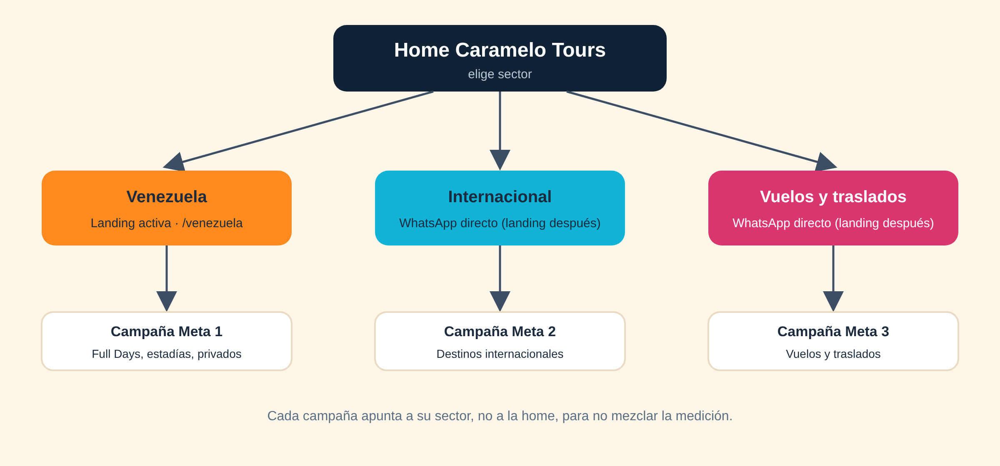

# Caramelo Tours · Fase 1 · El plano

7 de noviembre de 2026

## Resumen

Vamos a construir una sola web con una home que reparte a tres sectores, cada uno con su color y su campaña, sobre la línea gráfica Brújula Costa con video y movimiento.

- **Línea gráfica elegida:** Brújula Costa, con crema cálido, video del mar, puntas de caramelo en las formas y letra cursiva en los acentos. Está en el lienzo de diseño (home de escritorio y versión celular).
- **Tres sectores:** Venezuela (Full Days, estadías y viajes privados), Internacional (destinos fuera del país, sin fijar cuáles porque se irán abriendo) y Vuelos y traslados (nacionales e internacionales).
- **Por ahora solo Venezuela tiene landing propia** (`venezuela.html`, la lista de precios mejorada con todos los destinos). Internacional y Vuelos y traslados cotizan directo por WhatsApp hasta que tengan su landing.
- **Una web, una landing por sector:** cada campaña de Meta cae en la landing de su sector, con su color, su mensaje y su medición, para no mezclar campañas. Mientras no existan las otras dos, esas campañas apuntan al WhatsApp.
- **Contacto oficial:** WhatsApp +58 424 251 1630, Instagram y TikTok @caramelotoursoficial, correo caramelotour22@gmail.com (tomados de tu lista de precios).
- **Alcance de esta fase:** marca, público, competencia, estructura del sitio y primera experiencia del visitante. El diseño detallado del hero y el copy vienen en las fases 2 y 4.

## Marca

Caramelo Tours se vende como "la dulce manera de viajar": una agencia cercana y alegre que hace fácil lo que suele ser complicado, desde un Full Day hasta un vuelo internacional.

| Aspecto | Definición |
| --- | --- |
| Promesa | La dulce manera de viajar (frase de tu lista de precios) |
| Personalidad | Cálida, alegre, cercana, confiable |
| Tono | Tuteo, frases cortas, cero tecnicismos; un asesor humano siempre a la vista |
| Qué la diferencia | Atención por WhatsApp con persona real, cupos claros, precios visibles |
| Elementos del logo | Caramelo (puntas del envoltorio), sol, palmera, mar |
| Colores del logo | Rosa, naranja, amarillo, turquesa, azul marino |
| Color por sector | Naranja: Venezuela. Turquesa: Internacional. Rosa: Vuelos y traslados |

**Reglas de uso del logo**

- Siempre con márgenes de seguridad y sin botones flotantes encima.
- Sobre video o fondos oscuros va dentro de un círculo blanco, porque el archivo actual (JPG) tiene fondo blanco.
- Pendiente: pedir el logo en vector o PNG transparente para la versión final.

## Público

Hay tres públicos distintos y por eso van separados. Lo que sigue son hipótesis de trabajo a partir de tu lista y tu negocio; hay que validarlas con los datos de Instagram, TikTok y WhatsApp.

| | Venezuela (Full Days y privados) | Internacional | Vuelos y traslados |
| --- | --- | --- | --- |
| Quién compra | Familias, parejas y grupos de amigos que quieren playa un día o un fin de semana | Personas que viajan fuera del país (destinos por definir) | Quien necesita un vuelo o un traslado, dentro o fuera del país |
| Qué busca | Salida segura, fecha clara, qué incluye, buen precio | Confianza y acompañamiento, pagar en su moneda | Mejor precio, horarios, equipaje, escalas |
| Qué le frena | Miedo a estafa o a que no haya cupo; no ve fotos reales | Pagar desde otro país, desconfianza | Comparar con otros buscadores; costo total |
| Cómo llega | Reels e Instagram, TikTok, recomendación | Anuncios en Meta y grupos de WhatsApp | Búsqueda y anuncios de oferta |
| Acción principal | Reservar por WhatsApp o pago | Cotizar por WhatsApp (por ahora) | Cotizar por WhatsApp (por ahora) |
| Pago probable | Pago Móvil, Zelle, tarjeta | Mercado Pago, transferencia | Tarjeta, Mercado Pago, Zelle |

## Competencia

El hueco está en juntar en un solo lugar lo local y lo cercano: Full Days con cupos y fotos reales, más pasajes, con atención humana por WhatsApp y pagos pensados para ambos países. Esta búsqueda es preliminar: se basó en resultados de búsqueda del 7 de noviembre de 2026, sin abrir cada página, así que hay que revisar a fondo antes de decidir precios o mensajes.

| Tipo | Ejemplos encontrados | Lo que hacen bien | Hueco para Caramelo |
| --- | --- | --- | --- |
| Buscadores de pasajes | [Despegar Argentina, Buenos Aires a Caracas](https://www.despegar.com.ar/vuelos/BUE/CCS/vuelos-a-caracas-desde-buenos+aires) | Comparan muchas opciones y precios | Atención humana, pago local y acompañamiento en el corredor |
| Aerolíneas directas | [Copa Airlines, Venezuela a Argentina](https://www.copaair.com/es/vuelos-desde-venezuela-a-argentina) y [Conviasa, reanudación de vuelos Caracas a Buenos Aires](https://aviacionline.com/conviasa-reanudo-sus-vuelos-entre-caracas-y-buenos-aires) | Venden su propio pasaje, con precio de partida visible | La oferta de rutas ha cambiado con los años (hubo suspensiones y reanudaciones); verificar el estado actual antes de prometer rutas |
| Full Days en Venezuela | Agencias y cuentas de Instagram; la prensa los describe como el plan vacacional accesible, por ejemplo [LaPatilla](https://lapatilla.com/2022/07/28/los-full-day-son-el-consuelo-para-las-vacaciones-de-los-venezolanos/) y [El Diario](https://eldiario.com/2024/02/05/cuanto-cuesta-morrocoy-y-precios-de-los-full-day/) | Mucha oferta, precios de entrada bajos | Pocas webs con cupos en vivo, pago fácil y confianza visible |

**Para cerrar en la próxima ronda:** pedirte 3 a 5 agencias que consideres competencia directa (de Full Days y de pasajes) para revisar su web, precios, redes y cómo cobran.

## Estructura

La home sirve para elegir sector. Hoy solo Venezuela tiene landing; Internacional y Vuelos y traslados abren el WhatsApp con un mensaje ya escrito. Cuando se creen sus landings, cada campaña de Meta apuntará a la de su sector y no a la home, para medir y optimizar por separado.

Las URLs y los nombres de campaña que siguen son propuestas para ajustar.

| Landing | URL propuesta | Qué se mide | Color |
| --- | --- | --- | --- |
| Venezuela (activa) | /venezuela | Clics a WhatsApp y reservas por salida | Naranja |
| Internacional (después) | /internacional | Cotizaciones y reservas | Turquesa |
| Vuelos y traslados | /vuelos-traslados | Cotizaciones y reservas | Rosa |

Cada landing lleva su propio píxel de Meta y sus propios nombres de campaña, y solo muestra el mensaje y las ofertas de su sector.

## Experiencia inicial

En los primeros 10 segundos la persona tiene que entender qué vendemos, ver el mar en movimiento y saber qué hacer después.

1. **Segundos 0 a 3:** video del mar y el título "Reserva tu próxima aventura" con un solo botón principal.
2. **Segundos 3 a 7:** elige su sector (Venezuela, Internacional o Vuelos y traslados) o usa el buscador con pestañas.
3. **Segundos 7 a 10:** ve salidas con cupos y precio, o toca WhatsApp con el número siempre visible.

**Pagos y monedas.** La lista actual cotiza en REF; hay que decidir la moneda base de la web (por ejemplo USD) y cómo mostrar la tasa para ARS y VES. El brief pide Mercado Pago y transferencia para Argentina, y Pago Móvil, Zelle y tarjetas internacionales (Stripe, Kushki o similar) para Venezuela e internacional. Mi sugerencia: arrancar con confirmación de pago por WhatsApp y automatizar después los métodos que más se usen.

**Riesgos a vigilar**

- Los vuelos con marca blanca dependen de un consolidador y de normas de emisión: es la parte más lenta y debe empezar a evaluarse ya.
- Los videos pesan: el objetivo del brief es cargar en menos de 2,5 segundos en celular, así que se comprimen y solo el hero carga primero.
- Personas en videos y fotos: confirmar que autorizaron su aparición antes de publicarlos en la web o en anuncios.
- Los materiales actuales son de baja resolución; para la versión final se necesitan los originales.

## Pendientes

Para pasar a la Fase 2 (el hero y la propuesta de valor, con alternativas para prueba A/B) necesito esto de ti:

- [ ] Videos y fotos originales en alta resolución
- [ ] Qué playa o cayo es cada video
- [ ] Logo en vector o PNG transparente
- [ ] Moneda base de los precios (REF, USD u otra) y cómo quieres mostrar la tasa
- [ ] 3 a 5 agencias que consideres competencia directa
- [ ] Testimonios reales y permiso de las personas que salen en videos y fotos
- [ ] Qué métodos de pago ya tienes activos hoy en cada país
- [ ] Si ya tienes dominio y quién será el proveedor de pasajes (consolidador o marca blanca)
